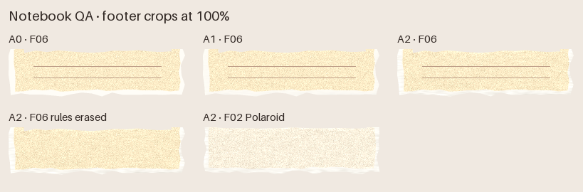

# P4 Notebook QA regression and A3 proposal

The old classifier required two rows of exact RGB (190, 159, 137). Recolouring that ink in A2 removed the match while preserving both lines. The gate could still pass with an empty notebook list.

The updated classifier compares darkness against the paper on **both sides** of the stroke and checks opacity, continuity, span and spacing in the lower foot. Two separate strokes covering at least half the packed sprite width are required. A plain Polaroid foot is evaluated separately. With Mixed Handcut geometry v1, the notebook gate defaults to required. A composition can explicitly opt out using `mixedHandcutRequireNotebook: false`. No ZIP layout field is added.

| Evidence | Notebook | Polaroid | Geometry |
| --- | --- | --- | --- |
| A0 original ZIP | F06, rows 269/285 | F02 | pass |
| A1 original ZIP | F06, rows 269/285 | F02 | pass |
| A2 original ZIP | F06, rows 269/285 | F02 | pass |
| A2, actual F06 rules covered with neighbouring paper in memory | None | F02; the erased foot also resembles Polaroid | fail with notebook required |

Rows are relative to the packed F06 sprite. The erased sample keeps all six apertures, both silhouettes and the stamp/ticket results. Its alpha has zero changed pixels. Existing PNGs, ZIPs and stored reports were left unmodified. [Regression report and original ZIP hashes](notebook-regression.json)

## A3 proposal for approval

**Start with a material change inside D04's existing cutline.** Use a photo-free procedural or licensed lace swatch with coarse, staggered stitches and alternating dense and loose strands. Align the stitch pattern to the final width and height of D04 so narrow detail survives scaling. Cover the cutline and keep the current eyelet alpha. Pixel-check both the neutral atlas and the finished page. Keep the six photos and SUBJECT out of all static sources and compare the exact SUBJECT asset and silhouette against A2.

**Render contact shadow from the moving piece at composition time.** Compute it from the transformed mask of the movable paper or lace, using a small offset and blur in final page coordinates. Draw it on the receiving lower layer immediately before the caster, and keep the foreground, face regions and SUBJECT unaffected. Exclude shadows from the RGBA cutting atlas and from each sprite alpha. Preview, import and export must use the same composition rule. For persistent shadow settings, strict v1 JSON cannot carry extra attributes. Propose an opt-in, versioned render contract with per-layer settings under the existing layer ID, explicit handling by the importer and a shared reconstruction test. Keep older v1 kits locked. Until that contract is approved, any renderer-only mock is comparison evidence.

**If openwork or an extra physical layer is needed, request separate approval.** Opening lace holes would change D04 alpha. Repack that sprite only in a new atlas and derive a tight source bbox, retain the single outer White Cutline and paper bridges, check holes and bridge widths at actual print size and keep the frame aperture masks identical. If a physical underlay is added, assign a new D code and unique z, an explicit source rectangle and target, and a connected printable piece with its own White Cutline. Update the expected piece count and atlas QA, check >=12 px gutters and components at alpha 1/8/16/24, then regenerate JSON and all four PNGs from the same source. In either case, rerender from archived JSON, require exact pixel reconstruction, audit static sources and all seven sentinels, and hash the new kit. A0/A1/A2 remain immutable.

Suggested acceptance order after approval: review D04 at page scale and 100%, then move one decorative layer in an isolated fixture to see whether the shadow follows it. Compare SUBJECT, photo masks and joins in blank/checker views. Stop for user approval before B–D. This change contains no A3 implementation.
