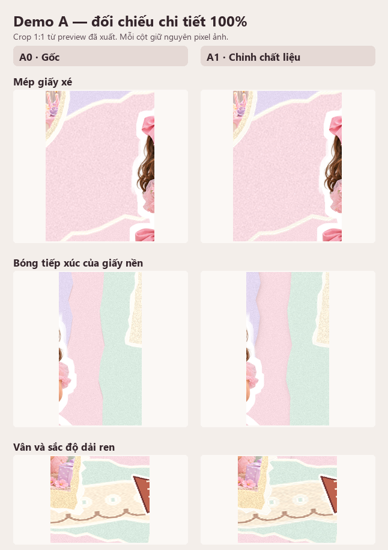

# P4 Visual Refinement A0/A1

This is an offline, Demo A-only experiment. Run it against a local locked P4 workflow and a new output directory.

```text
python -B scripts/tinix-mcp/refine_demo_a.py <locked-workflow> <new-output-directory>
```

The script copies the seven illustration assets and source manifest byte-for-byte. It shades RGB within the existing frame, paper, and lace sprites, and softens the contact shadows of the four flattened background sheets. It preserves the entire atlas alpha channel and does not bake silhouettes from replaceable layers into the backdrop. It exports the existing five-member layout format. It does not import the ZIP, select a demo, or touch the runtime service.

## Local result

- Original workflow a48e8de6-a645-4cc2-8c81-5042a1d7e64c, generator baseline 5b40882. All 94 existing files matched their pre-run SHA-256.
- Atlas alpha delta and RGB delta outside alpha were both zero. Visible RGB changed at 127,040 atlas pixels. Background RGB changed at 170,618 pixels.
- Layout JSON was byte-identical. Both kits rebuilt the corresponding placeholder and illustrated preview pixel-for-pixel. Source and geometry QA passed. Six windows, 17 pieces at alpha 1/8/16/24, minimum gap 22 px, and no outside-mask pixels in any of the seven sentinels.
- A0 ZIP SHA-256: 12bca271823a0f01d84b2577298fe6f3081c648f644dfb8b1f76e4e7ef1f6502
- A1 ZIP SHA-256: e6ad26f50fa6b1d3de90023ed94295ffcbcb6ab18b450f22658072131e909239

The soft edge on the background sheets is more natural. Lace and the frame paper have a smaller visible change. The existing SUBJECT cutline is untouched and still reads bright. The lace keeps the original outline, which limits how much it can read as a dimensional fabric trim. A1 awaits visual approval. The seven separate source illustrations and both material ZIPs remain local.

## Visual review

Each image compares A0 on the left with A1 on the right. The contact sheet keeps the displayed crops at their original pixel dimensions.



- Full page · [Demo](compare-demo.png) · [Blank](compare-blank.png) · [Checkerboard](compare-checker.png)
- 100% · [Torn edge](100pct-paper-edge.png) · [Contact shadow](100pct-fixed-paper-shadow.png) · [Lace](100pct-lace.png) · [Polaroid](100pct-polaroid.png) · [Ticket](100pct-ticket.png) · [SUBJECT](100pct-subject.png) · [Shoes](100pct-subject-shoes.png)
- RGBA sheet · [Light background](rgba-light.png) · [Dark background](rgba-dark.png)
- Technical evidence · [Pixel-diff and QA](report.json) · [SHA-256 for all 14 evidence files](SHA256SUMS.txt)

The PNGs and JSON are byte-for-byte copies of the previous experiment outputs. The contact sheet arranges existing crops for review.
